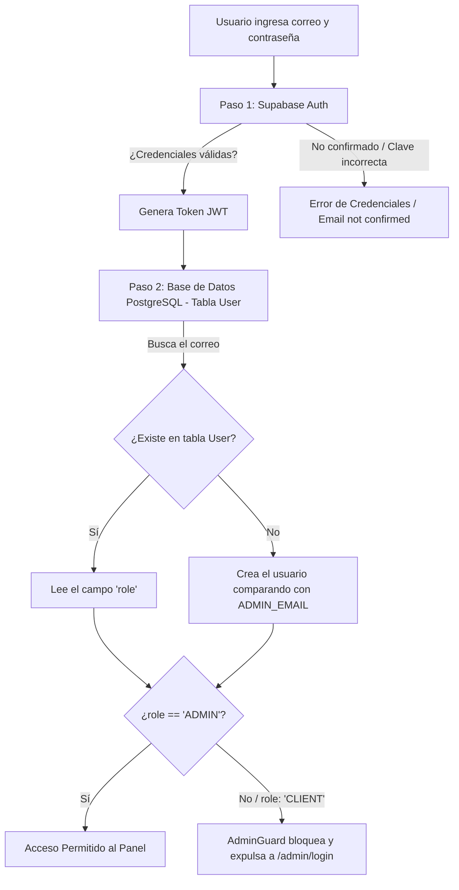

# Diagnóstico de Bloqueo de Acceso Administrativo y Supabase Auth

**Fecha:** 3 de Noviembre de 2026  
**Proyecto:** El Rincón del Mate (v0.1)  
**Problema reportado:** Tras modificar o agregar usuarios en el panel de Supabase Auth, ningún usuario puede ingresar al Panel Administrativo de la tienda.

---

## 1. La Causa Raíz: La Arquitectura de Doble Capa

En esta aplicación, el acceso al sistema depende de **dos sistemas distintos que deben estar sincronizados**:

---

## 2. Los 4 Puntos Críticos de Falla Identificados

### Punto 1: El rol en la base de datos quedó como `CLIENT`
Si el usuario ya existía en la tabla `User` de la base de datos PostgreSQL con `role = 'CLIENT'`, cuando inicia sesión:
* `AuthService.login` verifica que existe.
* **No actualiza su rol a `ADMIN`** aunque su correo coincida con `ADMIN_EMAIL`.
* La respuesta devuelve `{ role: 'CLIENT' }`.
* El frontend (`adminGuard`) comprueba `user.role === 'ADMIN'`. Como es `CLIENT`, **lo rebota de inmediato a `/admin/login`**.

### Punto 2: Correo no confirmado en Supabase Auth (`Email not confirmed`)
Cuando se crea o edita un usuario manualmente desde el dashboard de Supabase (Authentication > Users):
* Por defecto Supabase exige confirmación de correo vía enlace.
* Hasta que el usuario no esté en estado verde `Confirmed`, Supabase bloquea el inicio de sesión arrojando: `Email not confirmed` o `Invalid login credentials`.

### Punto 3: Desfase entre el correo en Supabase Auth y `ADMIN_EMAIL` en `.env`
* En `backend/.env` está configurado: `ADMIN_EMAIL="rincondelmatebo@gmail.com"`.
* Si en Supabase Auth se creó el usuario con otro correo o mayúsculas distintas, la comparación falla y se le asigna rol de cliente.

### Punto 4: Autocompletado del Frontend
* En [`frontend/src/app/features/auth/admin-login.component.ts`](file:///c:/Users/leona/Coding/Google%20AI%20Studio%20Proyects/el-rincon-del-mate-v.0.1/frontend/src/app/features/auth/admin-login.component.ts) línea 17:
  El campo `email` arranca con `admin@elrincondelmate.com` por defecto. Si el usuario intenta iniciar sesión sin cambiar ese correo, intentará entrar con credenciales inexistentes.

---

## 3. Plan de Acción y Solución Propuesta

1. **Robustecer `AuthService.login` en el Backend:**
   * Si el correo del usuario coincide con `ADMIN_EMAIL` (o si es el primer administrador registrado), asegurarse de que su rol en la tabla `User` se sincronice/eleve automáticamente a `ADMIN` si estaba en `CLIENT`.
2. **Sincronización de credenciales:**
   * Brindar un script o comando seguro para verificar y actualizar el rol del usuario en la base de datos PostgreSQL.
3. **Limpieza del Frontend:**
   * Quitar el valor hardcodeado en `admin-login.component.ts` para que use el correo correcto.

