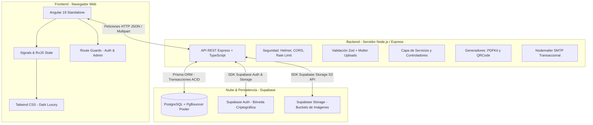

# Guía Maestra: Arquitectura, Herramientas, Dependencias y Buenas Prácticas

**Proyecto:** El Rincón del Mate (v0.1)  
**Propósito:** Inventario pedagógico integral y hoja de ruta para comprender el 100% del sistema.

---

## 1. El Gran Panorama: Arquitectura General

El sistema está construido bajo una **Arquitectura Cliente-Servidor Desacoplada (Decoupled Fullstack Monorepo)**:

---

## 2. Ecosistema del Frontend (Angular 19)

### Herramientas y Framework
1. **Angular 19 (Modo Standalone):**
   * Ya no usa los clásicos `NgModule`. Cada componente importa directamente lo que necesita (`imports: [CommonModule, FormsModule, ...]`).
   * **Nuevo Control Flow:** Usa sintaxis moderna `@if`, `@for`, `@switch` en lugar de directivas antiguas `*ngIf` o `*ngFor`.
2. **Angular Signals:**
   * Sistema reactivo moderno para manejar el estado de la sesión (`currentUser = signal<User | null>(...)`).
3. **RxJS (Reactive Extensions for JavaScript):**
   * Manejo de flujos de datos asíncronos y eventos en tiempo real: `Observable`, `Subscription`, operadores como `pipe`, `tap`, `switchMap`, `interval`.
   * **Smart Polling:** Temporizadores reactivos para consultar actualizaciones en segundo plano en `/pedido` y `/admin/pedidos`.
4. **Angular Router & Guards:**
   * Enrutamiento declarativo (`app.routes.ts`) y protección de rutas mediante funciones porteras (`canActivateFn`: `adminGuard`, `authGuard`).
5. **Tailwind CSS:**
   * Framework de estilos basado en clases utilitarias (`bg-mate-950`, `backdrop-blur-md`). Diseñado bajo la estética prémium **Dark Luxury**.
6. **Directivas y Pipes Personalizados:**
   * `AssetUrlPipe`: Resuelve dinámicamente si una imagen proviene de Supabase Storage, de la carpeta local `uploads` o de assets locales.
   * `ImgFallbackDirective`: Si una imagen no carga o se rompe, coloca una imagen alternativa automáticamente.

---

## 3. Ecosistema del Backend (Node.js & Express)

### Dependencias Principales (`package.json`)
* **Express.js (`express`):** Servidor HTTP minimalista para estructurar rutas RESTful.
* **TypeScript (`typescript`, `ts-node-dev`):** Tipado estático estricto para prevenir errores en tiempo de desarrollo.
* **Prisma ORM (`@prisma/client`, `prisma`):** Mapeo objeto-relacional para interactuar con PostgreSQL sin escribir SQL manual.
* **Zod (`zod`):** Biblioteca para validar datos que envían los usuarios (previene inyecciones o datos vacíos).
* **Multer (`multer`):** Middleware para recibir archivos binarios multipart (fotos de comprobantes de pago e imágenes de productos).
* **Nodemailer (`nodemailer`):** Cliente de correo para despachar alertas al comprador y al dueño mediante SMTP.
* **PDFKit (`pdfkit`):** Creación programática de documentos PDF vectoriales (comprobantes oficiales de pedidos).
* **QRCode (`qrcode`):** Generador de códigos QR en base64 para catálogo y pagos.
* **Helmet (`helmet`):** Configuración de cabeceras de seguridad HTTP contra ataques XSS y Clickjacking.
* **CORS (`cors`):** Control de acceso entre orígenes para que solo el frontend autorizado se comunique con el backend.
* **Express Rate Limit (`express-rate-limit`):** Previene ataques de fuerza bruta limitando peticiones por minuto.
* **Bcrypt (`bcryptjs`) y JWT (`jsonwebtoken`):** Criptografía para hashing y tokens de sesión.

---

## 4. Buenas Prácticas y Patrones de Arquitectura Implementados

1. **Arquitectura en Capas (Layered Architecture):**
   * `Routes` (Definen las URLs) ➡️ `Middlewares` (Filtran y validan) ➡️ `Controllers` (Reciben la petición y envían la respuesta) ➡️ `Services` (Contienen la lógica de negocio real) ➡️ `Prisma / Supabase` (Base de datos).
2. **Transacciones Atómicas de Base de Datos (Principios ACID):**
   * En `OrderService.createOrder` y `updateOrderStatus`, usamos `prisma.$transaction`. Si falla un solo paso (por ejemplo, se acaba el stock), toda la operación se revierte (Rollback) para evitar descuadres.
3. **Máquina de Estados Finita (State Machine):**
   * Los pedidos no pueden saltar a cualquier estado; tienen una tabla de transiciones estrictas (`ALLOWED_STATUS_TRANSITIONS`) con control bidireccional de inventario (restauración automática de stock al rechazar o cancelar).
4. **Idempotencia (Idempotency):**
   * Uso de métodos como `prisma.user.upsert` en semillas y scripts para garantizar que si se ejecuta 1 o 100 veces, el resultado en la base de datos sea siempre el mismo y no duplique registros.
5. **Autenticación en Dos Capas (Decoupled Auth):**
   * **Supabase Auth** almacena contraseñas cifradas y gestiona tokens.
   * **PostgreSQL / Prisma** administra el rol del usuario (`ADMIN` vs `CLIENT`) y su historial de compras.
6. **Manejo Centralizado de Excepciones:**
   * Clase `AppError` con códigos de error HTTP formales (`400`, `401`, `403`, `404`, `409`) capturados en un middleware global (`error.middleware.ts`).
7. **Entregabilidad Multipart de Correo:**
   * Emisión simultánea de HTML visual + texto plano (`text/plain`) con cabeceras anti-spam para asegurar llegada a la bandeja principal.

