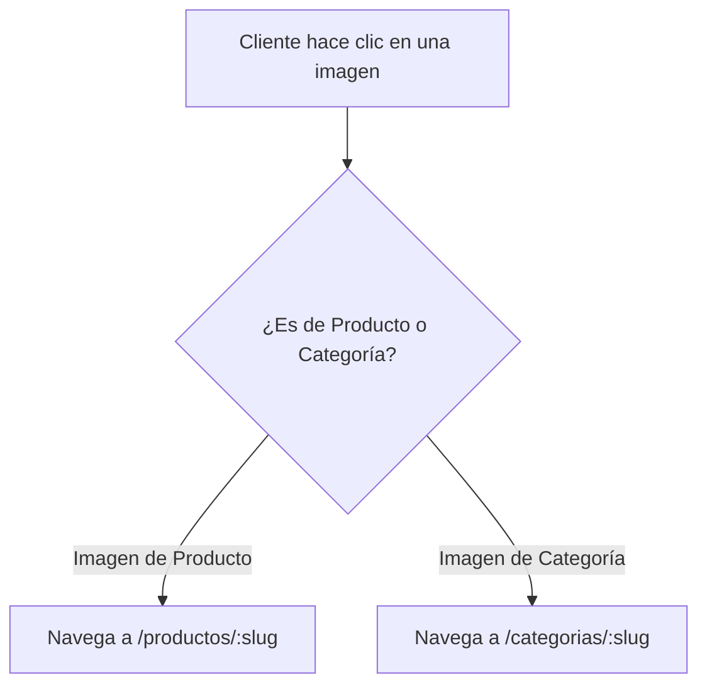

# Plan de Implementación: Navegación por Clic en Imágenes de Productos y Categorías

**Fecha:** 8 de Noviembre de 2026  
**Proyecto:** El Rincón del Mate (v0.1)  
**Objetivo:** Permitir que los clientes puedan navegar al detalle de cualquier producto o categoría simplemente haciendo clic en su imagen (o foto miniatura), en todas las vistas de la tienda.

---

## 1. Auditoría de las Vistas del Cliente

Hemos analizado todas las pantallas públicas del cliente para identificar dónde las imágenes actualmente son solo `
` estáticos en lugar de enlaces clickeables:

### Detalle de las pantallas a actualizar:

1. **Página de Inicio (`/` - `home.component.html`):**
   * **Productos Destacados:** El contenedor de la imagen (`
`) actualmente no es un enlace. Se convertirá en `<a [routerLink]="['/productos', product.slug]">` con `cursor-pointer` y efectos de hover suave.
   * **Categorías Principales:** Se asegurará que la imagen tenga `cursor-pointer` explícito y que el badge de categoría también sea interactivo.

2. **Catálogo General de Productos (`/productos` - `products.component.html`):**
   * El recuadro de la imagen de cada producto en la grilla se convertirá en un enlace directo `<a [routerLink]="['/productos', product.slug]">`.
   * El badge de la categoría sobre el nombre del producto enlazará a su respectiva categoría.

3. **Pantalla de Categorías (`/categorias` y `/categorias/:slug` - `categories.component.html`):**
   * En `/categorias`: Las tarjetas completas navegan a `/categorias/:slug`.
   * En `/categorias/:slug` (Listado de productos filtrados por esa categoría): La foto de cada producto actualmente es un `
`. Se convertirá en un enlace a `/productos/:slug`.

4. **Carrito de Compras (`/carrito` - `cart.component.html`):**
   * La miniatura de la foto del mate o accesorio (`w-20 h-20`) se convertirá en un enlace interactivo `<a [routerLink]="['/productos', item.product.slug]">` con `cursor-pointer` y efecto de escala al pasar el mouse, permitiendo al comprador revisar los detalles del producto que tiene en su carrito.
   * El nombre del producto también será un enlace clickeable.

5. **Detalle de Producto (`/productos/:slug` - `product-detail.component.html`):**
   * La etiqueta de categoría que aparece arriba del título principal del producto se convertirá en un enlace clickeable a `[routerLink]="['/categorias', product.category?.slug]"`.

---

## 2. Beneficios de Experiencia de Usuario (UX)
* **Intuitivo:** Los usuarios en móviles y computadoras esperan naturalmente que hacer clic o tocar una foto grande de producto los lleve a su ficha técnica.
* **Reducción de fricción:** Evita que el cliente tenga que buscar obligatoriamente el título pequeño de texto o el icono de ojo para poder ver más información.
* **Coherencia visual:** Añade micro-interacciones (`cursor: pointer`, transiciones de opacidad y zoom sutil `group-hover:scale-105`) en todas las pantallas.

---

## 3. Estado de la Implementación
* **Estado:** ✅ Completado y verificado con éxito.
* **Vistas actualizadas:**
  1. [`home.component.html`](file:///c:/Users/leona/Coding/Google%20AI%20Studio%20Proyects/el-rincon-del-mate-v.0.1/frontend/src/app/features/home/home.component.html): Imagen de producto y badge de categoría clickeables.
  2. [`products.component.html`](file:///c:/Users/leona/Coding/Google%20AI%20Studio%20Proyects/el-rincon-del-mate-v.0.1/frontend/src/app/features/products/products.component.html): Imagen de producto y categoría clickeables en el catálogo.
  3. [`categories.component.html`](file:///c:/Users/leona/Coding/Google%20AI%20Studio%20Proyects/el-rincon-del-mate-v.0.1/frontend/src/app/features/categories/categories.component.html): Imagen de producto clickeable en el listado de cada categoría.
  4. [`cart.component.html`](file:///c:/Users/leona/Coding/Google%20AI%20Studio%20Proyects/el-rincon-del-mate-v.0.1/frontend/src/app/features/cart/cart.component.html): Miniatura e imagen del producto clickeables en el carrito.
  5. [`product-detail.component.html`](file:///c:/Users/leona/Coding/Google%20AI%20Studio%20Proyects/el-rincon-del-mate-v.0.1/frontend/src/app/features/products/product-detail.component.html): Badge de categoría clickeable para explorar la colección.
* **Compilación Frontend:** TypeScript exitoso (código 0).
* **Compilación Backend:** TypeScript exitoso (código 0).

