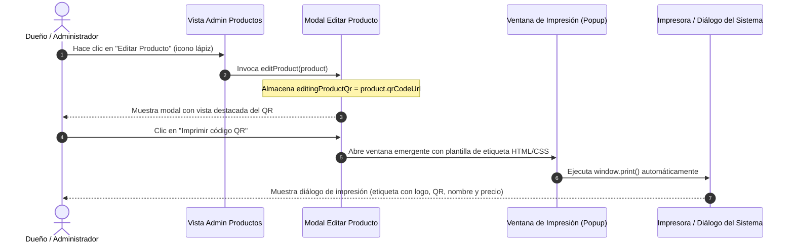

# Plan de Implementación: Vista e Impresión de Código QR en Modal de Edición de Producto

## 1. Contexto y Objetivo
En el panel administrativo del dueño, dentro de la sección **"Productos"** (`/admin/products`), actualmente los productos cuentan con un código QR generado automáticamente por el backend (`qrCodeUrl` almacenado en Base64 / Data URL) que enlaza directamente a la ficha pública del producto en la tienda (`/productos/:slug`).

En la tabla de productos ya existe una miniatura del QR, pero al abrir el modal de **"Editar Producto"**, el administrador no disponía de:
1. Una vista clara, nítida y destacada del código QR del producto seleccionado.
2. La funcionalidad de **"Imprimir código QR"** para generar una etiqueta física, sticker o comprobante de góndola listo para imprimir.

Este plan detalla la arquitectura, el diseño visual y el flujo técnico para incorporar ambas características de manera elegante y robusta.

---

## 2. Alcance de los Cambios

### Archivos Involucrados:
- [admin-products.component.ts](file:///c:/Users/leona/Coding/Google%20AI%20Studio%20Proyects/el-rincon-del-mate-v.0.1/frontend/src/app/features/admin-products/admin-products.component.ts)
  - Declaración de la variable `editingProductQr: string = ''`.
  - Asignación de `this.editingProductQr = p.qrCodeUrl || ''` en el método `editProduct(p: Product)`.
  - Limpieza de `editingProductQr` en `openModal()` y `closeModal()`.
  - Creación del método `printProductQr()` para abrir una ventana emergente estilizada con diseño de etiqueta comercial y lanzar el diálogo de impresión del navegador.
- [admin-products.component.html](file:///c:/Users/leona/Coding/Google%20AI%20Studio%20Proyects/el-rincon-del-mate-v.0.1/frontend/src/app/features/admin-products/admin-products.component.html)
  - Inclusión de la tarjeta `@if (isEditing)` con la vista previa del código QR, información descriptiva y los botones de acción ("Imprimir código QR" y "Descargar PNG").
- [README.md](file:///c:/Users/leona/Coding/Google%20AI%20Studio%20Proyects/el-rincon-del-mate-v.0.1/README.md)
  - Actualización de la documentación de casos de uso y panel administrativo (CU05 / Gestión de Productos).

---

## 3. Arquitectura y Flujo Técnico

---

## 4. Diseño de la Plantilla de Impresión de Etiqueta

La plantilla de impresión está diseñada en formato de etiqueta comercial (estilo ticket de góndola de 320px de ancho) con:
- Encabezado de marca: `🌿 El Rincón del Mate - Catálogo Oficial de Productos`
- Código QR de alta resolución (190x190 px) enmarcado y con fondo blanco.
- Nombre del producto en tipografía clara y destacada.
- Categoría del producto (pastilla decorativa).
- Precio oficial destacado en grande (`Bs. XX.XX`).
- Leyenda explicativa: *"Escanea este código con la cámara de tu celular para ver detalles, disponibilidad y comprar en línea."*
- Reglas CSS `@media print` para ocultar botones auxiliares y optimizar los márgenes sin desperdiciar papel.

---

## 5. Criterios de Aceptación y Pruebas
1. **Visibilidad condicional:** El bloque de QR solo debe mostrarse en el modal de **Editar Producto** (`isEditing === true`), no al crear un nuevo producto (`openModal()`).
2. **Visualización fiel:** La imagen del QR se visualiza sin distorsión ni pixelado.
3. **Impresión limpia:** Al pulsar "Imprimir código QR", se abre la vista de impresión con los datos actualizados del producto (nombre, precio, categoría y QR).
4. **Respaldo de descarga:** Incluye opción adicional para descargar el archivo PNG directamente si se desea usar en diseño gráfico o redes sociales.
5. **No romper estilos:** El modal mantiene su diseño responsivo con scroll interno (`max-h-[90vh] overflow-y-auto`).
